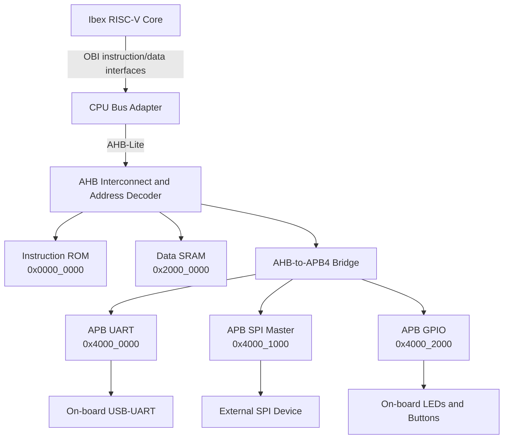

# Tang Nano 20K Ibex SoC

An educational RISC-V SoC platform targeting the Sipeed Tang Nano 20K FPGA. The project combines the lowRISC Ibex CPU core with a custom memory-mapped peripheral subsystem based on AHB-Lite and APB4.

The main engineering goals are to practice RTL design, bus integration, hardware/software co-design, simulation-based verification, and FPGA implementation using an ASIC-oriented design mindset.

## Project Status

This project is under active development.

| Area | Status |
| --- | --- |
| APB SPI master RTL | Unit-level simulation available |
| AHB address decoder | Implemented and under verification |
| AHB-to-APB4 bridge | Directed unit regression passes: 1,828 checks; system integration pending |
| Ibex integration | In progress |
| Bare-metal firmware | In progress |
| FPGA synthesis and timing results | To be documented |

The repository will be updated as each integration stage is verified. Results are only marked as complete after they have been reproduced through simulation or FPGA reports.

## Architecture



Ibex uses OBI-style instruction and data interfaces. The CPU bus adapter is responsible for translating CPU transactions into the system bus used by the AHB interconnect. The AHB-to-APB bridge then converts high-performance bus transactions into APB setup and access phases for low-speed peripherals.

## Design Scope

- RV32 RISC-V CPU integration based on lowRISC Ibex.
- AHB-Lite address decoding for instruction memory, data memory, and peripherals.
- AHB-Lite to APB4 protocol bridge with wait-state handling.
- Memory-mapped SPI master with configurable clock polarity, phase, divider, bit order, and chip select.
- APB UART for firmware logging and bring-up.
- APB GPIO for on-board LED and button control.
- Bare-metal C firmware with a custom linker script.
- SystemVerilog testbenches for peripheral and SoC-level verification.
- FPGA implementation target for the Sipeed Tang Nano 20K.

## Repository Layout

```text
tangnano-soc-portfolio/
|-- docs/                         # Architecture, register map, and verification guides
|   |-- memory_map.md
|   `-- ahb_bridge_simulation.md
|-- dv/                           # Simulation testbenches
|   |-- tb_ahb_to_apb_bridge.sv
|   |-- tb_apb_spi.sv
|   `-- tb_soc_top.sv
|-- fpga/
|   |-- tangnano20k.cst            # Board pin constraints
|   `-- build/                    # Gowin project configuration
|-- rtl/
|   |-- core/                     # CPU integration documentation
|   |-- interconnect/             # AHB decoder and AHB-to-APB bridge
|   |-- peripherals/              # APB UART, SPI, and GPIO
|   `-- soc_top.sv                # SoC integration scaffold
|-- sw/                           # Bare-metal firmware and linker script
`-- README.md
```

Public technical documentation belongs in `docs/`. Personal plans, learning
journals, local tool settings, and generated simulation/build outputs are
excluded from version control. Simulation executables should be written to
`work/`; the Gowin project configuration in `fpga/build/` remains versioned.


## Memory Map

The complete register definition is available in [`docs/memory_map.md`](docs/memory_map.md).

| Address Range | Bus | Block | Size | Description |
| --- | --- | --- | --- | --- |
| `0x0000_0000 - 0x0000_7FFF` | AHB | Instruction ROM | 32 KB | Firmware image and read-only data |
| `0x2000_0000 - 0x2000_7FFF` | AHB | Data SRAM | 32 KB | Runtime data, stack, and heap |
| `0x4000_0000 - 0x4000_0FFF` | APB | UART | 4 KB | Serial console and firmware logging |
| `0x4000_1000 - 0x4000_1FFF` | APB | SPI master | 4 KB | External SPI communication |
| `0x4000_2000 - 0x4000_2FFF` | APB | GPIO | 4 KB | LEDs and pushbuttons |

## Verification

The verification strategy follows a staged approach:

1. Verify peripheral register access at the APB level.
2. Verify SPI transfer behavior using a loopback model.
3. Verify address decoding and AHB-to-APB transaction sequencing.
4. Verify the complete SoC using a firmware image and a UART monitor.
5. Inspect waveforms to debug protocol, reset, and timing behavior.

### Run the SPI Unit Testbench

Using Icarus Verilog:

```bash
iverilog -g2012 -o sim_spi dv/tb_apb_spi.sv rtl/peripherals/apb_spi.v
vvp sim_spi
gtkwave tb_apb_spi.vcd
```

The SPI testbench configures the controller, transmits test bytes, applies a loopback response, polls the busy flag, and reads the received data.

### Run the AHB-to-APB Bridge Testbench

The self-checking bridge testbench and PowerShell commands are documented in
[`docs/ahb_bridge_simulation.md`](docs/ahb_bridge_simulation.md), including the
verified scenarios, regression results, known limitations, and waveform debugging steps.

### Run the SoC Testbench

The following is an integration command template. Full SoC execution remains
pending completion of the Ibex core, bus adapter, and firmware integration:

```bash
iverilog -g2012 -o sim_soc \
  dv/tb_soc_top.sv \
  rtl/soc_top.sv \
  rtl/interconnect/*.sv \
  rtl/peripherals/*.v

vvp sim_soc
```

The SoC testbench generates a 27 MHz clock, releases reset, monitors the UART TX signal, and records a VCD waveform for debugging with GTKWave.

## Build the Firmware

The firmware requires a 32-bit RISC-V GNU toolchain:

```bash
cd sw
riscv32-unknown-elf-gcc \
  -march=rv32imc \
  -mabi=ilp32 \
  -T link.ld \
  -nostartfiles \
  -O2 \
  -o firmware.elf main.c

riscv32-unknown-elf-objcopy -O verilog firmware.elf firmware.hex
riscv32-unknown-elf-objdump -d firmware.elf > firmware.dis
```

The generated `firmware.hex` can be loaded into the instruction ROM using `$readmemh` during simulation or FPGA initialization.

## FPGA Implementation

The target device is the Gowin GW2AR-LV18QN88C8/I7 on the Sipeed Tang Nano 20K.

1. Open `fpga/build/tangnano20k_soc.gprj` in Gowin EDA.
2. Add the RTL source files and `fpga/tangnano20k.cst` if they are not already included.
3. Run synthesis.
4. Run place and route.
5. Review the utilization and timing reports.
6. Program the generated bitstream using Gowin Programmer or `openFPGALoader`.

Example command:

```bash
openFPGALoader -b tangnano20k path/to/tangnano20k_soc.fs
```

## Engineering Focus

This project is intended to demonstrate practical understanding of:

- Synchronous RTL design and reset behavior.
- AHB-Lite address and data phases.
- APB setup and access phases.
- Memory-mapped register design.
- CPU and peripheral integration.
- Hardware/software interface design using volatile C registers.
- Simulation-driven debugging with waveforms.
- FPGA synthesis, resource utilization, and static timing analysis.

## Known Limitations

- The complete Ibex-to-system-bus integration is still being finalized.
- The current verification environment is primarily directed testing; coverage-driven and formal verification are future improvements.
- FPGA timing and utilization values will be added after the Gowin implementation flow has been completed.
- The design is an educational FPGA SoC and is not yet a silicon-qualified ASIC implementation.

## Future Work

- Complete and document the Ibex CPU bus adapter.
- Add AHB bridge and interconnect assertions.
- Add functional coverage and automated regression scripts.
- Add a reusable SystemVerilog verification environment.
- Run synthesis and static timing analysis on the target FPGA.
- Improve portability toward an open-source ASIC flow such as OpenLane.

## License

This repository contains original integration and peripheral RTL together with third-party components. Each third-party component remains subject to its original license. Refer to the Ibex repository and its license files for the licensing terms of the CPU core.
