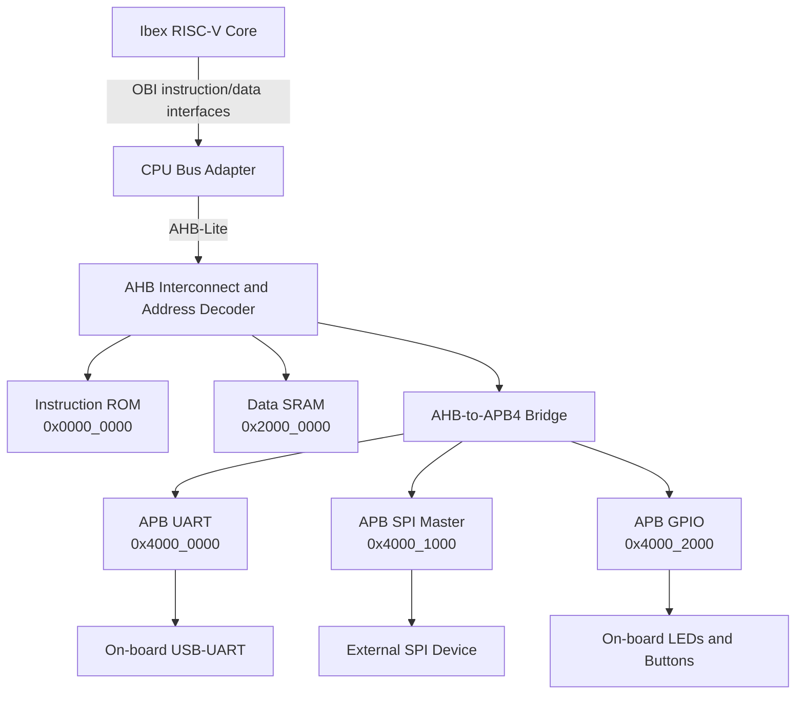

# Tang Nano 20K Ibex SoC

[](https://github.com/Alphonsusadt/tangnano20k-ahb-apb-soc/actions/workflows/regression.yml)

An educational RISC-V SoC platform targeting the Sipeed Tang Nano 20K FPGA. The project combines the lowRISC Ibex CPU core with a custom memory-mapped peripheral subsystem based on AHB-Lite and APB4.

The main engineering goals are to practice RTL design, bus integration, hardware/software co-design, simulation-based verification, and FPGA implementation using an ASIC-oriented design mindset.

## Quick Start

The Ibex core is already in this repository, in [`third_party/ibex`](third_party/ibex/VENDORED.md). A plain `git clone` is enough: there are no submodules, nothing to download, and no integration to do.

```bash
git clone https://github.com/Alphonsusadt/tangnano20k-ahb-apb-soc.git
cd tangnano20k-ahb-apb-soc
```

| Goal | Tools | Run from the repository root |
| --- | --- | --- |
| Run all tests | Icarus Verilog for the bus and peripheral tests; Verilator 5 and `riscv64-unknown-elf-gcc`, on Linux or WSL, for the Ibex test | `bash dv/run_regression.sh` |
| Run firmware on Ibex in simulation | Verilator 5 and `riscv64-unknown-elf-gcc`, on Linux or WSL | `bash dv/run_ibex_sim.sh` |
| Build the bitstream | Gowin EDA | `cd fpga/build && gw_sh ../build.tcl` |
| Program the board | Gowin Programmer | See [FPGA Implementation](#fpga-implementation) |
| Change the firmware | `riscv64-unknown-elf-gcc`, on Linux or WSL | Edit `sw/main.c`, then `make -C sw` |

The compiled firmware is checked in as `sw/firmware.hex`, so building the bitstream needs no RISC-V toolchain. `gw_sh` and `programmer_cli` are in the `IDE/bin` and `Programmer/bin` folders of the Gowin install, which the installer may not add to `PATH`.

`dv/run_regression.sh` prints one `PASS`, `FAIL`, or `SKIP` line per test, and skips any test whose tools are missing.

## Project Status

This project is under active development.

| Area | Status |
| --- | --- |
| APB SPI master RTL | Directed unit regression passes: 192 checks |
| APB UART RTL | Directed unit regression passes: 62 checks |
| AHB-Lite SRAM | Unit regression passes: 8,855 checks; SoC-level regression passes: 27 checks |
| AHB interconnect and default slave | Directed unit regression passes: 299 checks |
| APB write strobes (GPIO, UART, SPI) | Directed regression passes: 62 checks |
| AHB-to-APB4 bridge | Directed unit regression passes: 1,872 checks |
| SoC system without a CPU | Regression through the bus to the chip pins passes: 15,545 checks, including random traffic |
| FPGA self-test image, no CPU | Regression from the board pins passes: 175 checks, including injected faults |
| OBI-to-AHB adapter | Random regression passes: 1,351,409 checks across five traffic and wait-state profiles |
| Ibex integration | Firmware runs on Ibex in Verilator simulation: 133 checks from the chip pins, including misaligned store and ROM store traps, and an SPI exchange with a model of an external slave |
| Bare-metal firmware | Self-test, UART echo, and LED firmware runs in simulation and on the board |
| FPGA synthesis and timing with Ibex | Gowin place and route completes; 27 MHz constraint met in timing analysis (see [FPGA Implementation](#fpga-implementation)) |
| FPGA board test | CPU-free self-test image runs on a Tang Nano 20K: `SOC PASS` report, UART echo, LEDs, and S2 confirmed by hand. Ibex image runs on the same board: `IBEX PASS` report, UART echo, LEDs, and S2 confirmed by hand. SPI pins not yet measured |

The repository will be updated as each integration stage is verified. Results are only marked as complete after they have been reproduced through simulation or FPGA reports.

## Architecture



Ibex uses OBI-style instruction and data interfaces. The CPU bus adapter is responsible for translating CPU transactions into the system bus used by the AHB interconnect. The AHB-to-APB bridge then converts high-performance bus transactions into APB setup and access phases for low-speed peripherals.

## Design Scope

- RV32 RISC-V CPU integration based on lowRISC Ibex.
- AHB-Lite address decoding for instruction memory, data memory, and peripherals.
- AHB-Lite to APB4 protocol bridge with wait-state handling.
- Memory-mapped SPI master with configurable clock polarity, phase, divider, bit order, and chip select.
- APB UART for firmware logging and bring-up.
- APB GPIO for on-board LED and button control.
- Bare-metal C firmware with a custom linker script.
- SystemVerilog testbenches for peripheral and SoC-level verification.
- FPGA implementation target for the Sipeed Tang Nano 20K.

## Repository Layout

```text
tangnano-soc-portfolio/
|-- docs/                         # Architecture, register map, and verification guides
|   |-- memory_map.md
|   `-- ahb_bridge_simulation.md
|-- dv/                           # Simulation testbenches
|   |-- tb_ahb_interconnect.sv
|   |-- tb_ahb_sram.sv
|   |-- tb_ahb_to_apb_bridge.sv
|   |-- tb_apb_pstrb.sv
|   |-- tb_apb_spi.sv
|   |-- tb_apb_uart.sv
|   |-- tb_soc_sram.sv
|   |-- tb_fpga_top.sv
|   |-- tb_obi_to_ahb.sv
|   |-- run_ibex_sim.sh
|   |-- run_regression.sh         # Runs every self-checking test
|   |-- tb_soc_ibex.sv
|   |-- tb_soc_system.sv
|   `-- tb_soc_top.sv
|-- fpga/
|   |-- build.tcl                  # Batch build script
|   |-- build_spi_demo.tcl         # Batch build of the SPI demo image
|   |-- selftest_rom.hex           # ROM image checked by the self-test
|   |-- tangnano20k.cst            # Board pin constraints
|   |-- tangnano20k.sdc            # Clock constraint
|   `-- build/                    # Gowin project configuration
|-- rtl/
|   |-- core/                     # Ibex wrapper with the bus adapter, and FPGA clock gate
|   |-- fpga/                     # Board wrapper and self-test AHB master
|   |-- interconnect/             # AHB decoder, AHB-to-APB bridge, and OBI-to-AHB adapter
|   |-- memory/                   # AHB-Lite SRAM with byte and halfword writes
|   |-- peripherals/              # APB UART, SPI, and GPIO
|   `-- soc_top.sv                # SoC top level
|-- sw/                           # Bare-metal firmware, linker script, and compiled image
|-- third_party/ibex/             # Unmodified lowRISC Ibex source, Apache 2.0
`-- README.md
```

Public technical documentation belongs in `docs/`. Personal plans, learning
journals, local tool settings, and generated simulation/build outputs are
excluded from version control. Simulation executables should be written to
`work/`; the Gowin project configuration in `fpga/build/` remains versioned.


## Memory Map

The complete register definition is available in [`docs/memory_map.md`](docs/memory_map.md).

| Address Range | Bus | Block | Size | Description |
| --- | --- | --- | --- | --- |
| `0x0000_0000 - 0x0000_7FFF` | AHB | Instruction ROM | 32 KB | Firmware image and read-only data |
| `0x2000_0000 - 0x2000_7FFF` | AHB | Data SRAM | 32 KB | Runtime data, stack, and heap |
| `0x4000_0000 - 0x4000_0FFF` | APB | UART | 4 KB | Serial console and firmware logging |
| `0x4000_1000 - 0x4000_1FFF` | APB | SPI master | 4 KB | External SPI communication |
| `0x4000_2000 - 0x4000_2FFF` | APB | GPIO | 4 KB | LEDs and pushbuttons |

## Verification

The verification strategy follows a staged approach:

1. Verify peripheral register access at the APB level.
2. Verify SPI transfer behavior using a loopback model.
3. Verify address decoding and AHB-to-APB transaction sequencing.
4. Verify the complete SoC using a firmware image and a UART monitor.
5. Inspect waveforms to debug protocol, reset, and timing behavior.

### Run All Tests

```bash
bash dv/run_regression.sh
```

A test passes only if it exits cleanly and reports `0 failures`, and the script exits with 1 if any test fails. When the Ibex tools are present, it also checks that `sw/firmware.hex` matches the firmware source. Logs are written to `work/`. GitHub Actions runs the same script on every push, and treats a skipped test as a failure. The sections below run each test on its own.

### Run the SPI Unit Testbench

Using Icarus Verilog:

```bash
iverilog -g2012 -o sim_spi dv/tb_apb_spi.sv rtl/peripherals/apb_spi.v
vvp sim_spi
gtkwave tb_apb_spi.vcd
```

The SPI testbench configures the controller, transmits test bytes, applies a loopback response, polls the busy flag, and reads the received data.

### Run the AHB-to-APB Bridge Testbench

The self-checking bridge testbench and PowerShell commands are documented in
[`docs/ahb_bridge_simulation.md`](docs/ahb_bridge_simulation.md), including the
verified scenarios, regression results, known limitations, and waveform debugging steps.

### Run the Interconnect Testbench

`tb_ahb_interconnect` drives the interconnect with a pipelined master and three
scripted slaves. It checks decode boundaries, data-phase multiplexing, wait states,
and the two-cycle ERROR for unmapped addresses.

```bash
mkdir -p work
iverilog -g2012 -s tb_ahb_interconnect -o work/sim_ic \
  dv/tb_ahb_interconnect.sv \
  rtl/interconnect/ahb_interconnect.sv
vvp work/sim_ic
```

### Run the System Testbench

`tb_soc_system` forces a pipelined AHB-Lite master onto the undriven CPU bus of
`soc_top`, then checks GPIO, UART, and SPI at the chip pins. It also covers transfers
waiting behind an ERROR, register aliases, and random traffic against a reference
model. It does not replace firmware running on Ibex.

```bash
mkdir -p work
iverilog -g2012 -s tb_soc_system -o work/sim_system \
  dv/tb_soc_system.sv \
  rtl/soc_top.sv \
  rtl/memory/*.sv \
  rtl/interconnect/*.sv \
  rtl/peripherals/*.v
vvp work/sim_system
```

### Run the Write Strobe Testbench

`tb_apb_pstrb` checks that a GPIO, UART, or SPI register byte changes only when its
`PSTRB` bit is set, and that a transmission starts only when the data byte is valid.

```bash
mkdir -p work
iverilog -g2012 -s tb_apb_pstrb -o work/sim_pstrb \
  dv/tb_apb_pstrb.sv \
  rtl/peripherals/*.v
vvp work/sim_pstrb
```

### Run the SRAM Testbenches

`tb_ahb_sram` tests the SRAM alone, with directed cases, a walking-one address
test, and a random pipeline checked against a reference model. `tb_soc_sram` runs SRAM transfers through the
real interconnect and bridge by forcing the undriven CPU bus, with the CPU left
out (`USE_IBEX` is 0).

```bash
mkdir -p work
iverilog -g2012 -s tb_ahb_sram -o work/sim_sram dv/tb_ahb_sram.sv rtl/memory/ahb_sram.sv
vvp work/sim_sram

iverilog -g2012 -s tb_soc_sram -o work/sim_soc_sram \
  dv/tb_soc_sram.sv \
  rtl/soc_top.sv \
  rtl/memory/*.sv \
  rtl/interconnect/*.sv \
  rtl/peripherals/*.v
vvp work/sim_soc_sram
```

### Run the SoC Testbench

`tb_soc_top` is a smoke template with no CPU and no automatic checks, so its
message proves nothing. `dv/run_ibex_sim.sh` covers firmware running on Ibex:

```bash
iverilog -g2012 -o sim_soc \
  dv/tb_soc_top.sv \
  rtl/soc_top.sv \
  rtl/memory/*.sv \
  rtl/interconnect/*.sv \
  rtl/peripherals/*.v

vvp sim_soc
```

The SoC testbench generates a 27 MHz clock, releases reset, monitors the UART TX signal, and records a VCD waveform for debugging with GTKWave.

## Build the Firmware

`sw/firmware.hex` is checked in, so this step is needed only after changing the firmware. It builds on Linux or WSL with `riscv64-unknown-elf-gcc`, which also targets RV32:

```bash
make -C sw
```

This writes `sw/firmware.hex`, with one 32-bit word per line, which `$readmemh` loads into the instruction ROM. Commit the new image together with the source change. To use a toolchain with another prefix, pass it to `make`, for example `make -C sw CROSS=riscv32-unknown-elf-`.

## FPGA Implementation

The target device is the Gowin GW2AR-LV18QN88C8/I7 on the Sipeed Tang Nano 20K. `rtl/fpga/fpga_top.sv` wraps the SoC for the board. The [lowRISC Ibex](https://github.com/lowRISC/ibex) files it needs are in `third_party/ibex`, copied unchanged from commit `f4515520`.

Build the bitstream from `fpga/build/`. The batch script is the supported flow; the `.gprj` file does not list the Ibex sources.

```bash
cd fpga/build
gw_sh ../build.tcl
```

Check the build log for warning `EX3988`. It means the ROM image was not found, and the build still completes with an empty ROM.

Results with Gowin V1.9.11.03 Education and the firmware image:

| Metric | Result |
| --- | --- |
| Logic | 5,321 / 20,736 (5,222 LUT, 99 ALU) |
| Registers | 2,259 / 15,750 |
| Block RAM | 17 / 46 |
| Timing | 27 MHz constraint met, estimated Fmax 32.4 MHz |

Block RAM use grows with the firmware, because synthesis trims unused ROM contents. Only the clock is constrained; I/O timing is not. The tool also warns (`PR1014`) that the clock from pin 4 uses generic routing.

To test on the board, program SRAM from the repository root and open the USB serial port at 115200 baud:

```bash
programmer_cli --device GW2AR-18C --run 2 --fsFile fpga/build/impl/pnr/tangnano20k_soc.fs
```

| Observation | Meaning |
| --- | --- |
| `IBEX PASS` on the serial port after S1 is pressed | The firmware self-test passed on the CPU |
| `IBEX FAIL xx` | Test `xx` (hex) in `sw/main.c` failed |
| `!` | The CPU took a trap |
| Typed characters echo back | UART receive and transmit work through the CPU |
| LED0 blinks, LED1 on | Heartbeat and pass |
| LED2 on | Self-test failed |
| LED3 follows S2 | Button input reaches the LEDs through the CPU |

Run the matching simulation on Linux or WSL with Verilator 5.024 and `riscv64-unknown-elf-gcc`:

```bash
bash dv/run_ibex_sim.sh
```

Setting `USE_IBEX` to 0 and `BOOT_HEX_FILE` to `../selftest_rom.hex` in `fpga_top` builds the CPU-free self-test image instead. `dv/tb_fpga_top.sv` simulates that image:

```bash
iverilog -g2012 -s tb_fpga_top -o work/sim_fpga \
  dv/tb_fpga_top.sv rtl/fpga/fpga_top.sv rtl/fpga/ahb_selftest_master.sv \
  rtl/soc_top.sv rtl/memory/ahb_sram.sv rtl/interconnect/*.sv rtl/peripherals/*.v
vvp work/sim_fpga
```

### SPI Demo with an External Slave

The demo image sends each character typed on the serial port over SPI at 500 kHz in mode 0, and reports both directions, for example `SPI TX 62 RX 41`. A slave answers during the next transfer, so `RX` is the reply to the previous byte. The intended slave is an STM32F407 on SPI2. So far this has run only in simulation, against a model of that slave.

| Signal | Tang Nano 20K pin | STM32F407 pin |
| --- | --- | --- |
| SCK | 73 | PB13 |
| MOSI | 74 | PB15 |
| MISO | 71 | PB14 |
| CS | 72 | PB12 |
| GND | GND | GND |

Connect the grounds, but not the supply rails. Build the firmware on Linux or WSL, then build the bitstream from `fpga/build/`. The result is `impl/pnr/tangnano20k_spi_demo.fs`.

```bash
make -C sw firmware_spi_demo.hex NAME=firmware_spi_demo CFLAGS_EXTRA=-DSPI_DEMO
cd fpga/build
gw_sh ../build_spi_demo.tcl
```

## Engineering Focus

This project is intended to demonstrate practical understanding of:

- Synchronous RTL design and reset behavior.
- AHB-Lite address and data phases.
- APB setup and access phases.
- Memory-mapped register design.
- CPU and peripheral integration.
- Hardware/software interface design using volatile C registers.
- Simulation-driven debugging with waveforms.
- FPGA synthesis, resource utilization, and static timing analysis.

## Known Limitations

- The current verification environment is primarily directed testing; coverage-driven and formal verification are future improvements.
- Only the FPGA clock is constrained; I/O timing is not.
- CPU interrupts and the debug module are not connected.
- The UART and SPI have no FIFOs, and `GPIO_DIR` does not affect the pins; see [`docs/memory_map.md`](docs/memory_map.md).
- The SPI pins have not been measured on the board.
- The design is an educational FPGA SoC and is not yet a silicon-qualified ASIC implementation.

## Future Work

- Add AHB bridge and interconnect assertions.
- Add functional coverage.
- Add a reusable SystemVerilog verification environment.
- Constrain FPGA I/O timing.
- Improve portability toward an open-source ASIC flow such as OpenLane.

## License

Copyright 2026 Alphonsus Aditya Putera Wahyudi.

The original code in this repository is licensed under Apache 2.0; see `LICENSE`. The CPU core in `third_party/ibex` is a separate lowRISC project, also under Apache 2.0, and keeps its own license in `third_party/ibex/LICENSE`.
